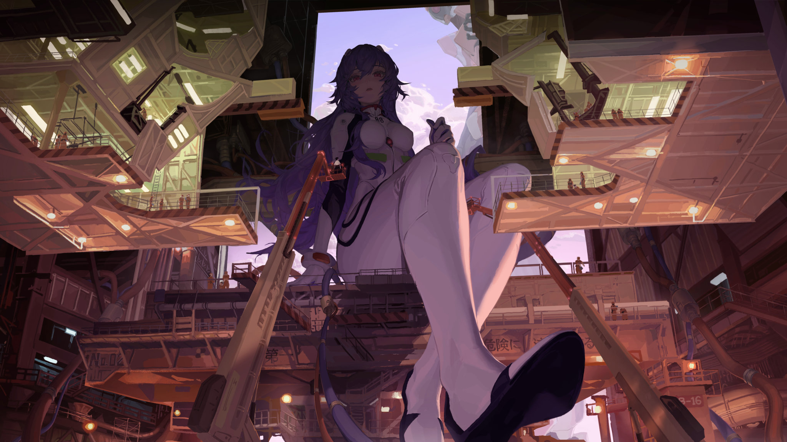

# Aurora Docks

A wallpaper theme for Discord, built for **Vencord**. Your own artwork sits behind very transparent, softly blurred surfaces, and the gradients are sampled from the picture itself — the periwinkle sky, the violet shadows under the gantries, the warm peach of the lit structures, and the coral in the small red details.



The picture ships with the theme, so nothing here depends on any other theme being installed.

## What it does

- **Your artwork as the app background**, fixed and framed on the figure and the lavender sky rather than cropped to the dockyard floor.
- **Very transparent surfaces** with a real blur behind them, so the picture stays visible while text stays readable. Chat, channel list, member list, user panel, modals and menus are each tuned separately.
- **Matching gradients** on the accent surfaces: the selected channel, unread pills, primary buttons, the scrollbar rail and the new-messages bar all wear the picture's own periwinkle-to-peach sweep.
- **Your profile is left alone** — see below.

## Install

In Discord, open **Vencord → Themes → Install from URL** and paste:

```
https://raw.githubusercontent.com/rayzist-spec/aurora-docks/main/aurora-docks.theme.css
```

The repository URL works too:

```
https://github.com/rayzist-spec/aurora-docks
```

Or install the file by hand: drop `aurora-docks.theme.css` into your Vencord themes folder and enable it in the Themes tab.

- macOS — `~/Library/Application Support/Vencord/themes/`
- Windows — `%appdata%\Vencord\themes\`
- Linux — `~/.config/Vencord/themes/`

Pick **Dark** in Discord's Appearance settings. The theme is built for the dark base and light mode is not supported.

**If another wallpaper theme is enabled, turn it off first.** Themes stack, and two wallpaper themes fighting over `--background-primary` is how you get a half-red, half-lavender app.

## Why your profile follows your settings again

Discord publishes the colours you choose for your own profile as `--profile-gradient-*`, `--user-profile-*` and `--profile-body-background-color`. Several popular themes — Novum among them — hardcode those, so the profile popout and the user panel render the theme's colours no matter what you pick. That is why changing your appearance appeared to do nothing.

**Nothing in this theme sets any of those variables.** Your profile therefore keeps following your Discord settings, and because the surfaces behind it are translucent, it still sits inside the glass. If you would rather pin a fixed profile look, there is a commented block at the end of the theme you can uncomment.

## Make it yours

Everything is a variable at the top of the file.

| Variable | What it does |
| --- | --- |
| `--aurora-wallpaper` | The background image. Point it at any URL. |
| `--aurora-wallpaper-position` | Framing. `center 22%` is tuned for a wide monitor. |
| `--aurora-alpha-*` | How see-through each surface is, `0` = invisible, `1` = solid. |
| `--aurora-blur` | The glass itself. `18px` by default; `0` turns the blur off. |
| `--aurora-wash-top` / `--aurora-wash-bottom` | The dusk wash over the picture. Raise these if text feels hard to read over a bright part of the art. |
| `--aurora-bloom-lilac` / `--aurora-bloom-peach` | The two colour blooms in the corners. |
| `--aurora-dusk` / `--aurora-ember` / `--aurora-twilight` | The gradients. |

The single fastest way to make the app more readable is to raise `--aurora-wash-top` and `--aurora-alpha-chat`. The fastest way to see more of the art is to lower them.

## Notes and limits

- **The picture is drawn inside the Discord window.** To see your actual desktop *through* Discord, the window itself has to be transparent, which the official Discord client cannot do — that needs a client built for it, such as Vesktop. The theme looks the same either way.
- Background blur needs a reasonably recent Chromium; Vencord's Discord builds all support it.
- Discord renames its CSS classes constantly, so the structural rules use prefix matching (`[class^="guilds_"]`) rather than exact hashes. Most of the theme rides on Discord's own colour variables, which change far less often.
- The artwork is **not** covered by this repository's licence — see `LICENSE`. If it is not yours to redistribute, keep the repository private or swap `assets/wallpaper.jpg`.

## Credits

Theme by [rayzist-spec](https://github.com/rayzist-spec). Built against [Vencord](https://vencord.dev).
